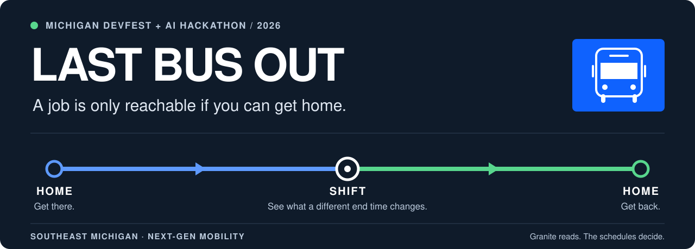
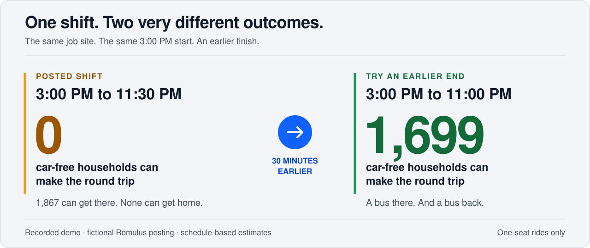
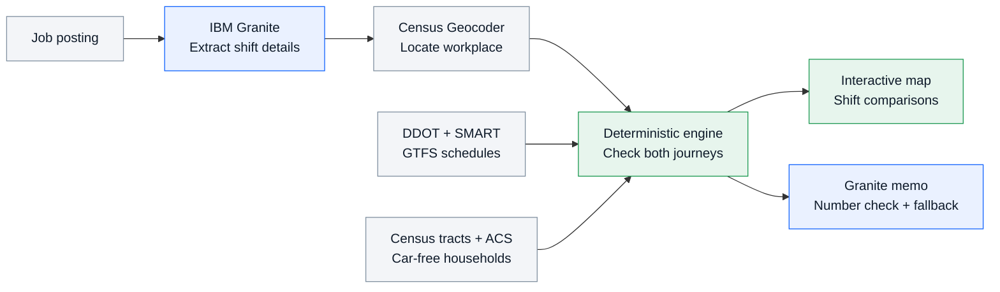

<p align="center">
  
</p>

<p align="center">
  
  
  
</p>

<p align="center">
  <a href="https://youtu.be/d1puFY888es"><strong>Watch the demo ↗</strong></a> ·
  <a href="#the-30-minute-difference">The 30-minute difference</a> ·
  <a href="#how-it-works">How it works</a> ·
  <a href="#run-locally">Run locally</a>
</p>

# Can workers get to this shift, and home again?

**Last Bus Out turns a job posting into a map of who can make the round trip by bus.** Built for the HR or operations lead setting shift times at a Southeast Michigan warehouse, hospital, or auto supplier, it makes the last bus home part of the scheduling decision.

Paste a posting. See the transit gap. Move the shift time and watch the map change.

**Michigan DevFest + AI Hackathon** · Detroit · November 13, 2026<br>
**Team Trav** · Next-Gen Mobility · v0.1.5

## Watch the one-minute demo

<a href="https://youtu.be/d1puFY888es">
  
</a>

**[▶ Play the demo on YouTube](https://youtu.be/d1puFY888es)** · Actual application footage · [Submission overview](SUBMISSION.md)

## The 30-minute difference

The demo starts with a **fictional Romulus warehouse posting**: 3:00 PM to 11:30 PM, with the familiar line *“Reliable transportation required.”*

The app's **“Last bus home” cutoff is 11:23 PM**. The shift ends seven minutes too late.



| Same workplace, different end time | Posted shift | Try an earlier end |
|---|---:|---:|
| Shift starts | 3:00 PM | 3:00 PM |
| Shift ends | 11:30 PM | **11:00 PM** |
| Car-free households with a round trip | **0** | **1,699** |

*These are recorded-demo results from the schedule and Census data used for the hackathon, not live counts or a forecast of hires. Moving only the end time shortens the shift. The “Last bus home” cutoff includes the estimated walk from the workplace to the stop.*

**The employer's question:** “If this is when work ends, who can still get home?” A route to work only answers half of it.

## From job posting to scheduling decision

1. **Paste the job.** Start with your own posting or one of three fictional samples: a Romulus warehouse, Midtown Detroit food service, or Sterling Heights assembly work.
2. **Check what Granite read.** IBM Granite extracts the employer, address, shift times, days, and notes. Inspect the fields or open the raw JSON.
3. **See the round trip.** The map colors census tracts across Wayne, Oakland, and Macomb counties and weights the results by car-free households.
4. **Try a better fit.** Drag the shift sliders to update the map immediately, or switch between extracted shifts to compare coverage. No new AI call is needed to recolor the map.
5. **Read the employer memo.** Granite summarizes the computed facts. A number checker rejects unsupported numbers and substitutes a plain template when validation fails.

| Map color | What it tells the employer |
|---|---|
| 🟢 **There and home** | A qualifying bus journey reaches the shift and returns after it. |
| 🟠 **There, but no bus home** | Workers can arrive, but there is no qualifying return within the allowed window. |
| ⚪ **No qualifying outbound journey** | The model cannot find a qualifying bus journey to the shift. Transfers are not modeled. |

## How it works

> **Granite reads the posting. The schedules decide.**

The AI handles language. Reachability and household totals come from explicit rules applied to public transit schedules and Census data.



| Layer | Built with | Responsibility |
|---|---|---|
| Language | IBM Granite on watsonx.ai | Parse messy postings and draft the memo. |
| Analysis | Python, pandas, NumPy | Evaluate scheduled journeys and aggregate car-free households. |
| API | FastAPI | Serve extraction, geocoding, reachability, and memo endpoints. |
| Interface | JavaScript, Leaflet, Esri basemap | Show tract coverage, last-bus timing, and instant shift comparisons. |
| Public data | DDOT, SMART, U.S. Census Bureau | Supply schedules, boundaries, and ACS B25044 household estimates. |

### Rules you can inspect

Defaults live in [`app/config.py`](app/config.py): stops within **800 m** at each end; estimated walking time at about **3 mph** with a **1.3× detour factor**; arrival **5–60 minutes before** the shift; a return departure within **45 minutes after** it ends; and a **90-minute maximum modeled one-seat journey**.

The documented demo build contains **10,541 stops**, **82 routes**, and **1,218 census tracts**, representing about **130,800 car-free households**. Of those tracts, **739** have a stop within walking distance. These describe the demo build; a fresh data download may differ.

## Run locally

You need **Git, Python 3.10+**, an **IBM watsonx.ai API key and project ID** for the default Granite provider, and a **[free Census API key](https://api.census.gov/data/key_signup.html)** to fetch the ACS data.

<details open>
<summary><strong>Windows · PowerShell</strong></summary>

```powershell
git clone https://github.com/CosmonautJones/last-bus-out.git
Set-Location last-bus-out
python -m venv .venv
.\.venv\Scripts\python -m pip install -r requirements.txt
Copy-Item .env.example .env
New-Item -ItemType Directory -Force data/raw | Out-Null
```

**Before continuing:** fill in `.env` with `WATSONX_API_KEY`, `WATSONX_PROJECT_ID`, and `CENSUS_API_KEY`. Download the [DDOT GTFS ZIP](https://www.detroitmi.gov/Portals/0/docs/deptoftransportation/pdfs/ddot_gtfs.zip) in a browser and save it as `data/raw/ddot_gtfs.zip` for full DDOT + SMART coverage.

```powershell
.\.venv\Scripts\python scripts\fetch_data.py
.\.venv\Scripts\python scripts\build_index.py
.\.venv\Scripts\python -m uvicorn app.main:app --port 8000
```

Open **[localhost:8000](http://localhost:8000)**. In another PowerShell terminal, from the repository directory:

```powershell
.\.venv\Scripts\python -m pytest -q tests
```

</details>

<details>
<summary><strong>macOS / Linux · Bash</strong></summary>

```bash
git clone https://github.com/CosmonautJones/last-bus-out.git
cd last-bus-out
python3 -m venv .venv
.venv/bin/python -m pip install -r requirements.txt
cp .env.example .env
mkdir -p data/raw
```

Fill in `.env` with `WATSONX_API_KEY`, `WATSONX_PROJECT_ID`, and `CENSUS_API_KEY`. Download the [DDOT GTFS ZIP](https://www.detroitmi.gov/Portals/0/docs/deptoftransportation/pdfs/ddot_gtfs.zip) in a browser and save it as `data/raw/ddot_gtfs.zip`.

```bash
.venv/bin/python scripts/fetch_data.py
.venv/bin/python scripts/build_index.py
.venv/bin/python -m uvicorn app.main:app --port 8000
```

Open **[localhost:8000](http://localhost:8000)**. In another terminal, from the repository directory:

```bash
.venv/bin/python -m pytest -q tests
```

</details>

<details>
<summary><strong>Alternative providers and troubleshooting</strong></summary>

| Need | What to do |
|---|---|
| Run Granite locally | Install and start Ollama, run `ollama pull granite3.3:8b`, then set `LBO_LLM_PROVIDER=ollama` in `.env`. |
| Try without model credentials | Set `LBO_LLM_PROVIDER=mock`. The regex fallback is visibly labeled **“not Granite.”** |
| Census download fails | Set `CENSUS_API_KEY`. The current fetch script requires it, even though the example environment file calls it optional. |
| DDOT is missing | Download its ZIP in a browser. The city portal blocks automated downloads; the fetch script does not retrieve it. An index can build with SMART alone, so check the build output and page footer. |
| Data was downloaded but the app says it is missing | Run `scripts/build_index.py` with the virtual environment's Python, then restart the server. |
| Refresh a feed | Back up and replace the relevant file in `data/raw/`, rebuild the index, and restart the server. The fetch script skips existing downloads. |

Both alternative providers still need built transit/Census data. Geocoding and basemap tiles also use network services. Never commit `.env`; credentials belong only in your local environment.

The tests use a small synthetic bus network and need no API keys or internet after dependencies are installed. They cover round trips, late shifts, arrival windows, overnight times, schedule interpolation, memo number checking, and the mock parser.

</details>

## Built for the hackathon

| Tool | Contribution |
|---|---|
| **IBM Bob IDE** | Core build tool: real-data pipeline work, Granite integration, Windows and basemap fixes. See the [Bob playbook](BOB_PLAYBOOK.md) and [usage evidence](bob_usage/). |
| **IBM watsonx.ai + IBM Granite** | `ibm/granite-4-h-small` reads postings and drafts employer memos. |
| **Claude · Anthropic** | Research, initial scaffold, interface polish, original documentation, and demo recording script. |
| **OpenAI Codex** | README presentation, documentation graphics, and setup-instruction review. |
| **IBM Code Engine** | Optional deployment target via [`Dockerfile`](Dockerfile); **not deployed for the demo**. |

No Google tools were used. The [submission overview](SUBMISSION.md), [hackathon kit](HACKATHON.md), and [Bob usage evidence](bob_usage/) document the entry. The demo can be recorded with [`scripts/record_demo.py`](scripts/record_demo.py), an optional Playwright tool.

## Data, assumptions, and limits

All analytical inputs are public: **DDOT and SMART GTFS schedules**, **Census ACS five-year table B25044**, **Census tract boundaries**, and the **Census Geocoder**. [Every source and its terms →](data/SOURCES.md)

- **Scheduled service, not live arrivals.** Tight connections may fail in practice. This is a planning tool, not a guarantee of a ride.
- **Demo feed dates:** DDOT July 2026 and SMART November 2026. The app footer reports the loaded data; refreshed feeds may produce different results.
- **One-seat rides only.** Transfers are not modeled, so some trips the model cannot find may still be possible.
- **Households, not people or hires.** Tract representative points approximate where people live, and Census estimates have margins of error.
- **Representative service days.** Weekday, Saturday, and Sunday calculations use representative dates from each feed, not every possible calendar exception.
- **Memo validation has limits.** Numbers are checked against computed facts; wording is only partly checked. The map and computed counts are the source of truth.

The sample job postings are **fictional**. The app does not collect or store personal profiles.

## Explore the code

| Start here | What you will find |
|---|---|
| [`app/engine.py`](app/engine.py) | Deterministic reachability and household totals. |
| [`app/granite.py`](app/granite.py) | Posting extraction, memo generation, and number validation. |
| [`app/main.py`](app/main.py) · [`app/geocode.py`](app/geocode.py) | FastAPI endpoints and Census geocoding. |
| [`scripts/fetch_data.py`](scripts/fetch_data.py) · [`scripts/build_index.py`](scripts/build_index.py) | Public-data downloads and index construction. |
| [`web/`](web/) | The single-page Leaflet interface. |
| [`samples/postings.json`](samples/postings.json) · [`tests/`](tests/) | Fictional postings and synthetic-network tests. |

**Next steps:** transfers between routes, route-level reliability, a workforce-board comparison view, and SMS summaries for job seekers. These are ideas for a future iteration, not current features.

---

<p align="center"><strong>A job is only reachable if you can get home.</strong><br><a href="https://youtu.be/d1puFY888es">Watch Last Bus Out in action ↗</a></p>
